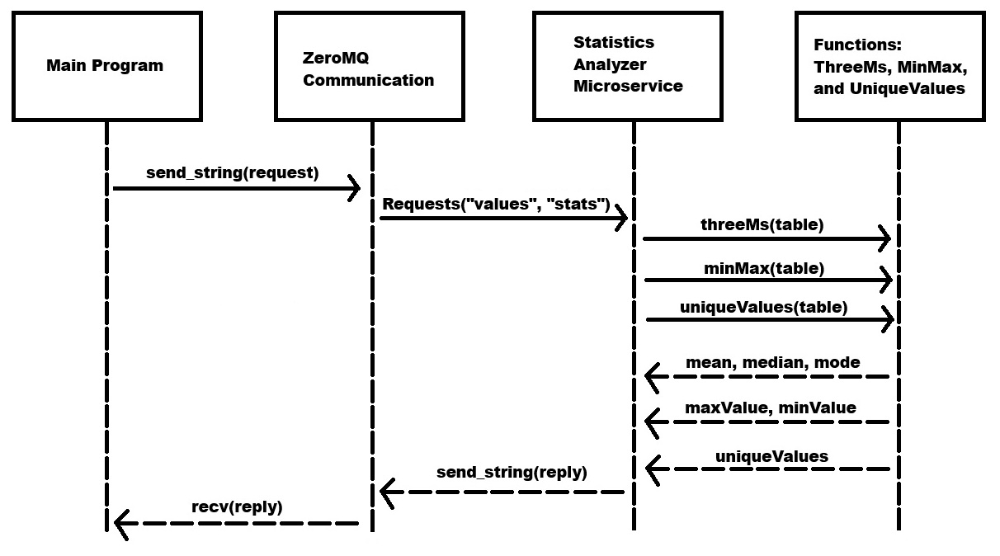

# Statistics Analyzer Microservice

This microservice takes a list of numbers and sends back stats about them (mean, median, mode, min, max, and unique values). Other programs talk to it through ZeroMQ.

To start it, run `python3 stats_service.py` (you need `pip install pyzmq` first). It listens on port 5556, and sending it "Q" stops it.

## How to request data
Connect a ZeroMQ REQ socket to `tcp://localhost:5556` and send a JSON string with:
- `"values"`: a list of numbers, like `[2, 4, 4, 10]`
- `"stats"`: a list of the stats you want, using any of `"mean"`, `"median"`, `"mode"`, `"min"`, `"max"`, `"unique"`

Example call:
```python
import json
import zmq

context = zmq.Context()
socket = context.socket(zmq.REQ)
socket.connect("tcp://localhost:5556")

request = {
    "values": [2, 4, 4, 10],
    "stats": ["mean", "median", "mode", "min", "max", "unique"],
}
socket.send_string(json.dumps(request))
```

## How to receive data
Call `recv()` on the same socket. The reply is a JSON string with one key for each stat you asked for. Mean, median, mode, min, and max are numbers like `5.0`. Unique is a list of each value once, with extra repeats in parentheses, so `[2, 4, 4, 10]` gives `["2", "4 (1)", "10"]`.

Example call:
```python
reply = json.loads(socket.recv().decode())
print(reply["mean"])    # 5.0
print(reply["unique"])  # ['2', '4 (1)', '10']
```

## UML sequence diagram
